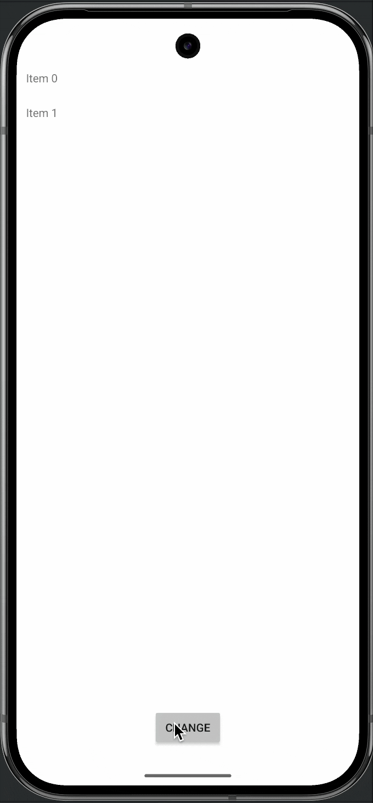

# irurueta-android-recycler-view-manager

Recycler view utility to simplify adapter notifications when collections of data are modified.

[](https://github.com/albertoirurueta/irurueta-android-recycler-view-manager/actions/workflows/develop.yml)
[](https://github.com/albertoirurueta/irurueta-android-recycler-view-manager/actions/workflows/main.yml)
[](https://github.com/albertoirurueta/irurueta-android-recycler-view-manager/actions/workflows/security.yml)
[](https://central.sonatype.com/artifact/com.irurueta/irurueta-android-recycler-view-manager)

[](https://sonarcloud.io/summary/new_code?id=albertoirurueta_irurueta-android-recycler-view-manager)
[](https://sonarcloud.io/summary/new_code?id=albertoirurueta_irurueta-android-recycler-view-manager)
[](https://sonarcloud.io/summary/new_code?id=albertoirurueta_irurueta-android-recycler-view-manager)
[](https://sonarcloud.io/summary/new_code?id=albertoirurueta_irurueta-android-recycler-view-manager)
[](https://sonarcloud.io/summary/new_code?id=albertoirurueta_irurueta-android-recycler-view-manager)
[](https://sonarcloud.io/summary/new_code?id=albertoirurueta_irurueta-android-recycler-view-manager)
[](https://sonarcloud.io/summary/new_code?id=albertoirurueta_irurueta-android-recycler-view-manager)
[](https://sonarcloud.io/summary/new_code?id=albertoirurueta_irurueta-android-recycler-view-manager)
[](https://sonarcloud.io/summary/new_code?id=albertoirurueta_irurueta-android-recycler-view-manager)
[](https://sonarcloud.io/summary/new_code?id=albertoirurueta_irurueta-android-recycler-view-manager)
[](https://sonarcloud.io/summary/new_code?id=albertoirurueta_irurueta-android-recycler-view-manager)

## Overview

This library contains a utility class to simplify adapter notifications when collections of data
are modified.

The class compares an old and a new collection of data and generates the necessary adapter
notifications when items are added, removed, moved or changed.



## Project Status

| | |
| --- | --- |
| Latest release | `1.1.5` |
| Language | Kotlin 2.4.21 (JVM target 17, builds on JDK 21) |
| Build tool | Gradle (Kotlin DSL), Android Gradle Plugin 9.5.1 |
| Platform | Android library (AAR) |
| Min / compile SDK | `minSdk` 26 (Android 8.0) / `compileSdk` 37 |
| License | Apache License 2.0 |
| CI | GitHub Actions: `develop` branch builds (snapshot publish), releases from `main` (Maven Central publish), security scans |
| Quality | SonarCloud, JaCoCo coverage, Android Lint |

## Documentation

- [Documentation site](https://albertoirurueta.github.io/irurueta-android-recycler-view-manager/) (Antora)
- [API reference](https://albertoirurueta.github.io/irurueta-android-recycler-view-manager/api/) (Dokka)
- [Usage guide](docs/modules/ROOT/pages/usage.adoc) (full walkthrough, also on the documentation site)
- [SonarCloud dashboard](https://sonarcloud.io/summary/new_code?id=albertoirurueta_irurueta-android-recycler-view-manager)
- [Changelog](CHANGELOG.md)

## Installation

Requirements:

- Android `minSdk` 26 (Android 8.0) or later.
- `mavenCentral()` among your project repositories.

Add the dependency to your module's `build.gradle.kts`:

```kotlin
dependencies {
    implementation("com.irurueta:irurueta-android-recycler-view-manager:1.1.5")
}
```

Groovy DSL (`build.gradle`):

```groovy
dependencies {
    implementation 'com.irurueta:irurueta-android-recycler-view-manager:1.1.5'
}
```

## Usage

You can refer to the sample app (`app/`) for a complete example of how to use this library, and to the
[usage guide](docs/modules/ROOT/pages/usage.adoc) for the full details.

In summary, the following steps are required:

1. Identify in your data model what identifies each item, and when the content of an item is
   considered to have changed. For instance, with the following data model:

   ```kotlin
   data class Item(val id: Long, val name: String)
   ```

   the `id` field identifies each item, and the `name` field determines whether the content of an
   item has changed.

2. Create a `RecyclerView.Adapter` and `RecyclerView.ViewHolder` as usual to inflate and update the
   views managed by the `RecyclerView`.

3. Create a `RecyclerViewManager` with the adapter and two comparators: one telling whether two
   items are the same entity, and one telling whether the content of the same entity is unchanged:

   ```kotlin
   private val adapter = ItemAdapter(emptyList())

   private val manager = RecyclerViewManager<ItemViewHolder, Item>(
       adapter,
       // ItemComparator: are both items the same entity?
       { item1, item2 -> item1.id == item2.id },
       // ItemContentComparator: is the content of the same entity unchanged?
       { item1, item2 -> item1.name == item2.name }
   )
   ```

4. Whenever your items change, first hand the new items to the adapter (its `getItemCount()` must
   already return the size of the new list), then call `notifyChanges` with the **old list first**
   and the new list second:

   ```kotlin
   fun updateItems(newItems: List<Item>) {
       val oldItems = adapter.items

       // 1. Hand the new data to the adapter first.
       adapter.items = newItems

       // 2. Compute the differences and notify the adapter (old list first!).
       manager.notifyChanges(oldItems, newItems)
   }
   ```

   This generates all the adapter notifications (inserts, removals, moves and changes) required to
   reflect the changes in the `RecyclerView`.

## License

Licensed under the Apache License 2.0. See [LICENSE](LICENSE).
